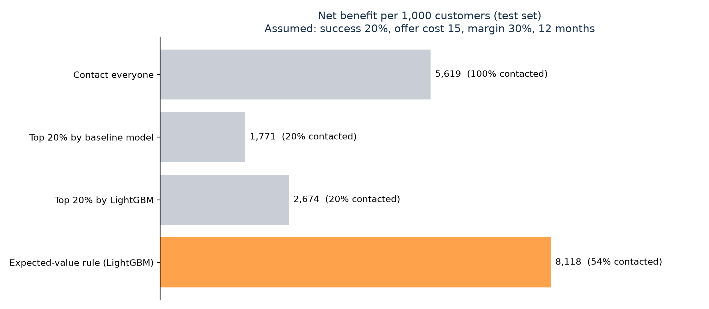
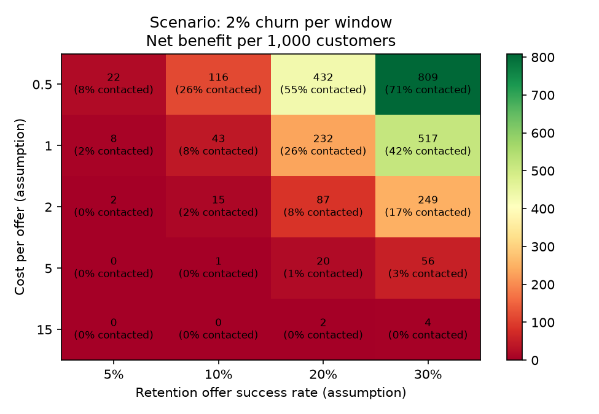

# Value-Based Customer Retention: Who Is Worth Contacting?

A telecom churn project that goes from prediction to a business decision: instead of contacting every high-risk customer, it targets those whose **expected value** of a retention offer is positive.

**Stack:** Python · pandas · scikit-learn · LightGBM · XGBoost · SHAP · matplotlib

Course project for GCI World 2026 (Matsuo-Iwasawa Lab, The University of Tokyo), using an anonymised dataset of 100,000 customers from "Company A".

## Results

| Model (test set, 20,000 customers) | ROC-AUC | Lift, top 10% |
|---|---|---|
| Baseline: logistic regression, 5 features | 0.573 | 1.20x |
| Logistic regression, all features | 0.628 | 1.35x |
| **LightGBM** | **0.693** | 1.60x |
| XGBoost | 0.693 | 1.59x |

LightGBM gains +0.112 to +0.128 AUC over the baseline (95% bootstrap interval) and scores 0.693 to 0.707 across five data splits. The signal is moderate.


## From score to decision

Contact a customer if `score x success rate x customer value - offer cost > 0`.



In a test-set simulation the rule contacts 54% of customers and earns 8,118 per 1,000 customers, against 5,619 when contacting everyone. Success rate (20%), offer cost (15), margin (30%) and horizon (12 months) are **assumptions**, and amounts are in the dataset's revenue units.

**The conclusion depends on churn prevalence.** The dataset has 49.6% churn. Re-weighted to a hypothetical 2%, a cost of 15 is no longer worthwhile, and the top 10% only justifies an offer below about 2.2.



## What drives the score


SHAP shows what the model uses, not what causes churn.

## Responsible use

Removing `ethnic`, `income` and `marital` changes average AUC from 0.698 to 0.697, while about 4% of contact decisions change. This does not guarantee fairness, since other variables can act as proxies.

## Limitations and next steps

- The model predicts churn risk, not response to an offer. A randomised pilot and then an uplift model are needed (see Ascarza, 2018).
- Business parameters are assumed, not measured.
- No observation dates, so there is no time-based validation.

## Reproduce

The data is course material and is **not included**. Place `Client.csv` and `Record.csv` in `data/`.

```bash
pip install -r requirements.txt
cd src
python run_models.py
python run_analysis.py
python run_prevalence.py
python run_robustness.py
python run_visuals.py
python run_improve.py     # optional: feature and tuning experiment
```

Or run `churn_value_targeting.ipynb`. The random seed is 42.

## Author

Angela Espinoza, Software Engineering student at UPC (Lima, Peru). [LinkedIn](https://linkedin.com/in/angelaespinozacruz)
