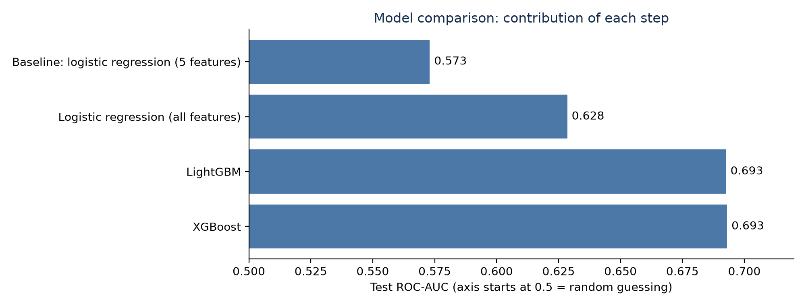
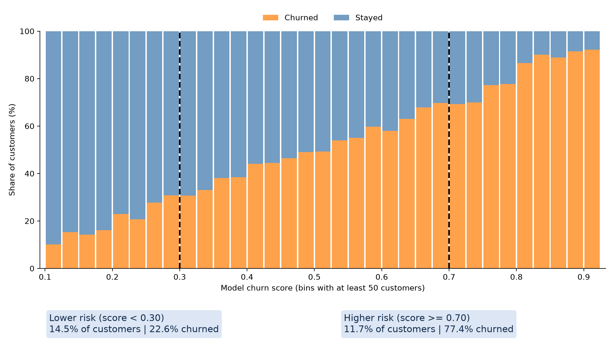
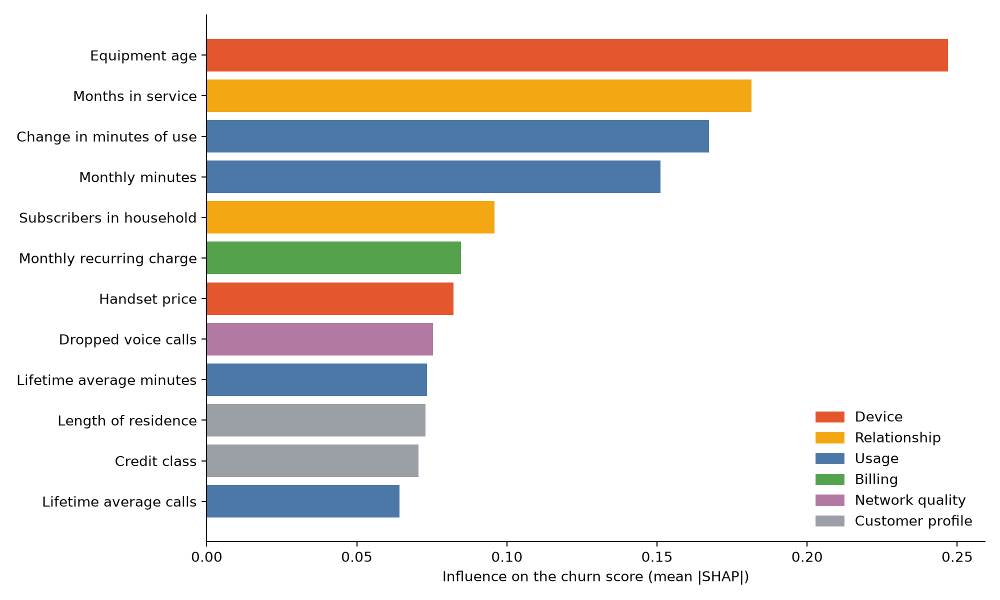
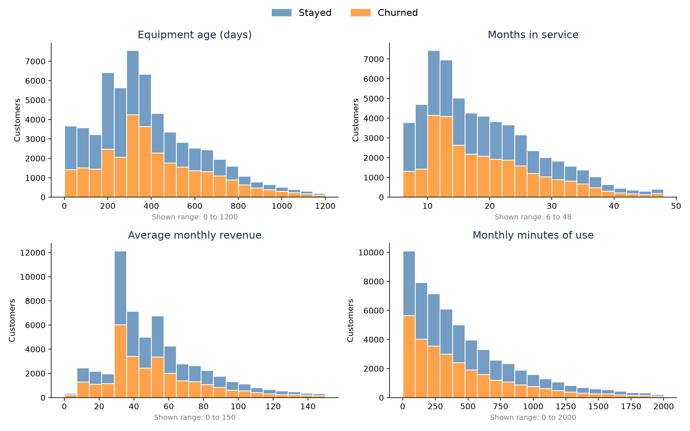
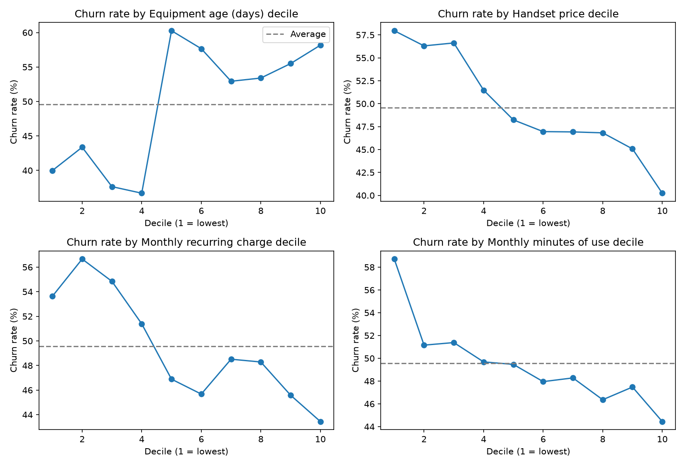

# Smart Retention Analytics

A reproducible churn model for a telecom operator that goes from **prediction to decision**: instead of contacting every high-risk customer, it targets those whose retention offer has a **positive expected value**, with the evaluation a business team would expect: lift, risk zones, SHAP explanations, sensitivity analysis and a check on sensitive variables.

**Stack:** Python · pandas · scikit-learn · LightGBM · XGBoost · SHAP · matplotlib

## Context

Telecom operators lose revenue when customers leave, but every retention offer also costs money. Using an anonymised dataset of 100,000 customers from "Company A", this repository answers two questions: *who is likely to leave*, and *who is worth contacting*.

## Highlights

- **Discrimination:** test ROC-AUC 0.573 (simple baseline) to **0.693** with LightGBM, a gain of +0.112 to +0.128 (95% bootstrap interval).
- **Data:** 100,000 customers, two linked tables, about 100 variables; 49.6% churn in the sample.
- **Rigor:** 60/20/20 train, validation and test split, leakage check, and 0.693 to 0.707 ROC-AUC across five data splits.
- **Risk zones:** customers scoring 0.70 or more (11.7%) churned at **77.4%**; those below 0.30 (14.5%) at 22.6%.
- **Business decision:** in a test-set simulation, the expected-value rule earns **8,118** per 1,000 customers vs 5,619 when contacting everyone, under stated assumptions.
- **Explainability and fairness:** SHAP drivers of the score, and almost the same performance without `ethnic`, `income` and `marital`.

## Results

| Step | Test ROC-AUC | Lift, top 10% |
|---|---|---|
| Baseline: logistic regression, 5 features | 0.573 | 1.20x |
| Logistic regression, all features | 0.628 | 1.35x |
| XGBoost | 0.693 | 1.59x |
| **LightGBM (selected)** | **0.693** | **1.60x** |

LightGBM and XGBoost tie. The signal is moderate, so the score should support decisions rather than replace judgement. Full table: [`results/model_comparison.csv`](results/model_comparison.csv).



### Risk zones



The 0.30 and 0.70 cut-offs are for illustration only.

### From score to decision

Contact a customer if `score x success rate x customer value - offer cost > 0`.

| Policy (base case) | Net benefit per 1,000 customers | Customers contacted |
|---|---|---|
| Top 20% by baseline model | 1,771 | 20% |
| Top 20% by LightGBM | 2,674 | 20% |
| Contact everyone | 5,619 | 100% |
| **Expected-value rule** | **8,118** | **54%** |


Success rate (20%), offer cost (15), margin (30%) and horizon (12 months) are **assumptions**, and amounts are in the dataset's revenue units.

### Sensitivity: churn prevalence changes the answer

The sample has 49.6% churn. Re-weighted to a hypothetical 2%, a cost of 15 is no longer worthwhile, and the riskiest 10% only justifies an offer below about 2.2.


### What drives the score

Equipment age, months in service and changes in usage are the most influential variables. SHAP shows what the model uses, not what causes churn.



### Responsible use

Removing `ethnic`, `income` and `marital` changes average ROC-AUC from 0.698 to 0.697, while about 4% of contact decisions change. This does not guarantee fairness, since other variables can act as proxies ([`results/robustness_summary.csv`](results/robustness_summary.csv)).

### Exploratory analysis





## Repository structure

```
src/
  common.py            # data loading, splits, bootstrap
  run_models.py        # leakage check and model comparison
  run_analysis.py      # EDA, calibration, SHAP, expected value
  run_prevalence.py    # churn prevalence scenarios
  run_robustness.py    # multiple splits and sensitive variables
  run_improve.py       # feature engineering and tuning trials
  run_visuals.py       # presentation charts
results/               # result tables
figures/               # charts
churn_value_targeting.ipynb
```

## How to run

The data is **not included**. With `Client.csv` and `Record.csv` in `data/`, install `requirements.txt` and run the scripts in `src/` in the order listed above (seed 42), or open the notebook.

## Limitations and next steps

- The model predicts churn risk, not response to an offer: a randomised pilot and then an uplift model are needed.
- Business parameters are assumed, not measured.
- No observation dates, so there is no time-based validation.
- Next: pilot design, uplift modelling, and validation on a later period.

## Author

Angela Espinoza, Software Engineering student at UPC (Lima, Peru). [LinkedIn](https://linkedin.com/in/angelaespinozacruz)
